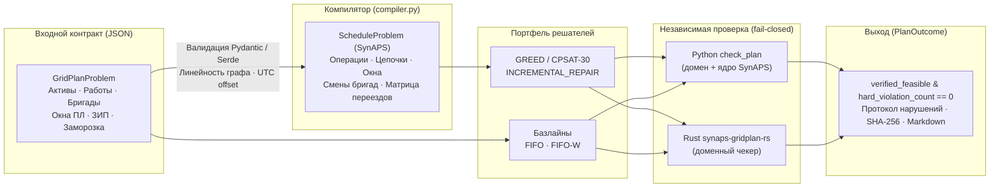

<div align="center">

<picture>
  <source media="(prefers-color-scheme: dark)" srcset="assets/brand/logo-horizontal-dark.svg">
  <source media="(prefers-color-scheme: light)" srcset="assets/brand/logo-horizontal-light.svg">
  
</picture>

### Календарно-ресурсное планирование и независимая верификация графиков ТОиР электросетевого оборудования поверх ядра [SynAPS](https://github.com/KonkovDV/SynAPS)

[](https://github.com/KonkovDV/SynAPS-GridPlan/actions/workflows/ci.yml?query=branch%3Amain)
[](https://www.python.org/)
[](LICENSE)
[](https://docs.astral.sh/ruff/)
[](http://mypy-lang.org/)
[](CITATION.cff)

</div>

---

| Поле | Значение |
| --- | --- |
| **Версия пакета** [V1] | **0.1.8** (`pyproject.toml`, `src/synaps_gridplan/versions.py`) |
| **Ветка по умолчанию** | `main` |
| **Пин ядра SynAPS** [V2] | [`6178c93b705ff58be21fa74a98651883a2da1169`](https://github.com/KonkovDV/SynAPS/commit/6178c93b705ff58be21fa74a98651883a2da1169) |
| **Уровень готовности** [V3] | TRL 4 по ISO 16290: лабораторные фикстуры, не пилот на предприятии (самооценка; не сертификация по ГОСТ Р 58048-2017; УГТ5 не заявляется — [`docs/UGT_GOST_R_58048.md`](docs/UGT_GOST_R_58048.md)) |
| **Словарь статусов** | Приёмка плана (`PlanOutcome.ok`) требует одновременно статуса в `{optimal, feasible}`, `verified_feasible = True` и `hard_violation_count == 0`. Эвристики (`GREED`, `FIFO`, `FIFO-W`, `INCREMENTAL_REPAIR`) никогда не выставляют `optimal`. Статус `optimal` выдаётся только если `CPSAT-30` доказал оптимум скомпилированной модели **и** независимый доменный чекер подтвердил `0` жёстких нарушений. При проверке внешнего JSON сохранённый флаг `optimal` не переиздаётся (`optimality_origin = "imported_not_reproven"`) |
| **Нативный контур (Rust)** | `native/synaps-gridplan-rs` (`cargo test --locked`) — независимый доменный чекер и календарный базлайн `FIFO`; не вызывает решатель `GREED`/`CP-SAT` и не подменяет проверку ядра `SynAPS` |
| **Тестовый инвариант** [T1] | `docs/TEST_COUNT.txt` (регенерируется через `python scripts/export_test_count.py`; CI падает при расхождении с `pytest --collect-only`) |
| **Реестр утверждений** | [`docs/CLAIMS_REGISTRY.md`](docs/CLAIMS_REGISTRY.md) · пакет воспроизведения: `python scripts/evidence_bundle.py` |
| **Границы модели** | [`docs/LIMITS.md`](docs/LIMITS.md) (обладает приоритетом над презентациями и заявками) · [`docs/limitations.md`](docs/limitations.md) · [`AUDIT.md`](AUDIT.md) |
| **Автор** | Коньков Д. В. (`@KonkovDV`) |

---

## Оглавление

1. [Назначение и архитектурная позиция](#1-назначение-и-архитектурная-позиция)
2. [Что поставляется в репозитории и что не заявляется](#2-что-поставляется-в-репозитории-и-что-не-заявляется)
3. [Математическая модель и граница компиляции](#3-математическая-модель-и-граница-компиляции)
4. [Портфель решателей и семантика `OPTIMAL`](#4-портфель-решателей-и-семантика-optimal)
5. [Лабораторные стенды и воспроизводимые результаты](#5-лабораторные-стенды-и-воспроизводимые-результаты)
6. [Быстрый старт и интерфейс командной строки](#6-быстрый-старт-и-интерфейс-командной-строки)
7. [Инженерные уроки и контекст SOTA (2025–2026)](#7-инженерные-уроки-и-контекст-sota-20252026)
8. [Навигация по документации и конкурсным материалам](#8-навигация-по-документации-и-конкурсным-материалам)
9. [Структура репозитория](#9-структура-репозитория)

---

## 1. Назначение и архитектурная позиция

При составлении месячных и оперативных графиков технического обслуживания и ремонта (ТОиР) в электросетевых и генерирующих компаниях диспетчерская служба одновременно сводит:
- квалификацию и допуск выездных бригад (`required_skills`);
- сменные графики и окна доступности персонала (`shift_calendar ∩ availability`);
- время переезда между подстанциями, фидерами и опорами (`travel_minutes`);
- согласованные окна вывода оборудования в ремонт (заявки ПЛ, `OutageWindow`);
- технологическую последовательность операций (например, «вывод в ремонт → работа на оборудовании → испытания → ввод в работу»);
- запреты одновременного отключения взаиморезервирующих элементов (`SimultaneousOutageBan`);
- наличие запасных частей и материалов на складе (`SparePart`) и неприкосновенность уже утверждённых диспетчерских слотов (`FrozenAssignment`).

В традиционной практике эти ограничения сводятся вручную в таблицах или фиксируются постфактум в учётной системе. При сдвиге одной заявки или появлении аварийного дефекта пересчёт вручную приводит либо к накладкам по оборудованию и срыву окон ПЛ, либо к лишним переездам и простою бригад.

**`SynAPS-GridPlan`** — доменный контур планирования и верификации графиков ТОиР поверх комбинаторного ядра [`SynAPS`](https://github.com/KonkovDV/SynAPS). Архитектура опирается на два принципа:

1. **Двухслойное разделение (Utility Outage Scheduling Layer 1 vs Layer 2).** В соответствии с промышленной практикой крупных энергосистем (Hydro-Québec TMS, CP 2022; Barral et al., CPAIOR 2024; см. [`PRACTICE.md`](PRACTICE.md) и [`docs/sota-cp-2026.md`](docs/sota-cp-2026.md)) `SynAPS-GridPlan` решает **первый (комбинаторный ресурсно-календарный) слой**: назначает бригады, окна ПЛ, технологические цепочки и таблично заданные запреты совмещения. **Второй слой** — расчёт потокораспределения AC/DC, токовых перегрузок, уровней напряжения и критерия N-1 — остаётся в специализированном электрическом симуляторе энергосистемы.
2. **Принцип fail-closed (независимая верификация поверх любого решателя).** Ни один план, построенный эвристикой (`GREED`, `FIFO`, `FIFO-W`, `INCREMENTAL_REPAIR`), точным решателем (`CPSAT-30`) или загруженный из внешнего JSON, не признаётся допустимым сам по себе. Независимый верификатор (`checker.py` на Python и `synaps-gridplan-rs` на Rust) заново собирает индекс входной задачи и проверяет все доменные и ресурсные инварианты. Если обнаружено хотя бы одно жёсткое нарушение, возвращается `verified_feasible = False`, а CLI завершается с кодом возврата `2`.



### Допустимое утверждение о продукте (Allowed claim)

> На детерминированных синтетических стендах электросетевого и генерирующего ТОиР (`res_severny`, `emergency_day`, `gres_block`, `dual_feed_hall`, `medium`, `stress`) `SynAPS-GridPlan` строит расписания работ и проверяет их независимым верификатором (Python и Rust) по правилам квалификации и смен бригад, переездов, окон отключения ПЛ, линейных цепочек технологического предшествования, эксклюзивности оборудования во время ремонта, попарных запретов одновременного вывода, складских квот ЗИП и заморозки согласованных слотов. Любое расписание с ненулевым числом жёстких нарушений отклоняется с кодом возврата `2`.

---

## 2. Что поставляется в репозитории и что не заявляется

| Поставляется и проверяется в CI | Не заявляется и не входит в скоуп |
| --- | --- |
| Строгая схема входной задачи `GridPlanProblem` и результата `PlanOutcome` (`extra="forbid"`, `deny_unknown_fields`, обязательные часовые пояса ISO-8601 `Z`/`+03:00`) | Расчёт потокораспределения AC/DC, уровней напряжения, токов КЗ, динамической устойчивости и критерия **N-1** |
| Компилятор доменной задачи в `SynAPS` (`compiler.py`): пересечение смен `shift_calendar ∩ availability`, дробление многодневных работ по сменам, переезды, линейные цепочки, заморозка окон | Оптимизация или прямое моделирование показателей **SAIDI / SAIFI** как целевой функции |
| Независимый верификатор `check_plan` (Python) и нативный крейт `synaps-gridplan-rs` (Rust, 58 модульных тестов `#[test]`) | Живые производственные выгрузки ПАО «Россети», ПАО «ЭЛ5-Энерго», Конаковской ГРЭС или других ДЗО |
| Точный решатель `CPSAT-30` (OR-Tools CP-SAT через `SynAPS`), эвристика `GREED`, оперативный ремонт плана `INCREMENTAL_REPAIR`, базлайны `FIFO` и `FIFO-W` | Готовые промышленные коннекторы к 1С:ТОИР, SAP PM, Maximo, SCADA/EMS/OMS или парсеры CSV/XLSX в составе пакета |
| Fail-closed приёмщик JSON-заявок `synaps_gridplan.extract` (`NOT_JSON`, `MISSING_SPARE_QUANTITY`) | Сертификация по ГОСТ Р 58048-2017, аттестация КИИ по **187-ФЗ** или номер записи в Едином реестре российского ПО ([`docs/ru_software_registry.md`](docs/ru_software_registry.md)) |
| Воспроизводимые синтетические стенды (`B1`–`B5`, `B7`), генератор пакета доказательств `scripts/evidence_bundle.py`, аудит формулировок `scripts/lint_claims.py` и SBOM (`sbom/`) | Статус партнёра или подрядчика ПАО «Россети» (в конкурсных анонсах «Россети» — соорганизатор программы, а не заказчик GridPlan) |

### Что доказывает и чего не доказывает зелёный статус CI

- **Зелёный CI доказывает**, что на чистой виртуальной машине при зафиксированных lock-файлах (`requirements.lock`, `Cargo.lock`) и пине `SynAPS` `6178c93` проходят все модульные, имущественные и негативные тесты Python (`3.12`, `3.13`) и Rust (`cargo test --locked`), статическая типизация `mypy`, линтер `ruff check src tests scripts benchmark`, проверка `pip-audit` / `cargo-audit`, сверка `sbom/`, контроль текста презентации (`extract_deck_text.py --check`), линтер запрещённых формулировок (`lint_claims.py`) и числовые гейты реестра утверждений [`docs/CLAIMS_REGISTRY.md`](docs/CLAIMS_REGISTRY.md).
- **Зелёный CI не доказывает** готовность к промышленному вводу на подстанции без участия диспетчера, полноту электрической проверки режима (N-1), универсальную оптимальность эвристики `GREED` на произвольных графах или наличие проверенного сертификата доказательства (DRCP / VeriPB) поверх солвера CP-SAT.

---

## 3. Математическая модель и граница компиляции

Ниже приведена формальная спецификация реализованного в `0.1.8` контракта и точное распределение ограничений между компилятором `SynAPS` и независимым пост-чекером.

### 3.1. Множества и переменные

- **Горизонт планирования:** полуинтервал $[H_{\text{start}}, H_{\text{end}})$, заданный метками времени ISO-8601 со смещением часового пояса; все времена внутри компилятора приводятся к целым минутам относительно $H_{\text{start}}$.
- **Активы $A$:** единицы оборудования (`Asset`: линия, трансформатор, выключатель, секция шин, ввод зала).
- **Бригады $C$:** выездные бригады (`Crew`), каждая из которых характеризуется множеством квалификаций $S_c$, параллельной ёмкостью $\text{max\_parallel}_c \ge 1$, базой дислокации $\text{home}_c$, сменным графиком $\mathcal{S}_c$ (`shift_calendar`) и окнами доступности $\mathcal{A}_c$ (`availability`).
- **Окна отключения $W$:** заявки на вывод оборудования (`OutageWindow`) $w = (a_w, [\underline{w}, \overline{w}), \text{approved}_w, \text{frozen}_w)$.
- **Склад ЗИП $P$:** позиции запасных частей (`SparePart`) с наличным остатком $q_p \in \mathbb{Z}_{\ge 0}$, временем поставки $\text{lead}_p \ge 0$ и опциональной датой пополнения.
- **Работы $J$:** заявки на ремонт (`MaintenanceJob`) $j$ с длительностью $d_j > 0$, требуемыми навыками $R_j$, признаком необходимости отключения $\text{outage}_j \in \{0, 1\}$, допустимыми окнами $W_j \subseteq W$, директивным интервалом $[r_j, l_j]$, списком предшественников $\text{pred}(j)$ и списком требуемых позиций ЗИП $P_j \subseteq P$.
- **Искомое назначение** для каждой работы $j \in J$: кортеж $(c_j, s_j, e_j, w_j)$, где $c_j \in C$ — назначенная бригада, $[s_j, e_j)$ — интервал выполнения (или последовательность суточных частей при дроблении сменами), $w_j \in W \cup \{\varnothing\}$ — используемое окно отключения.

### 3.2. Что компилируется в модель ядра `SynAPS` (`compiler.py`)

1. **Допуск по квалификации:** работа $j$ может быть назначена только бригаде $c$, для которой $R_j \subseteq S_c$ (`eligible_work_centers`).
2. **Временны́е окна и согласованные заявки ПЛ:** если $\text{outage}_j = 1$, допустимый интервал выполнения работы пересекается с объединением одобренных окон $\bigcup_{w \in W_j, \text{approved}_w = 1} [\underline{w}, \overline{w}) \cap [r_j, l_j]$.
3. **Сменные календари бригад (`WorkCenter.calendar`):**
   - Для каждой бригады строится пересечение $\mathcal{K}_c = \mathcal{S}_c \cap \mathcal{A}_c$.
   - Если оба списка $\mathcal{S}_c$ и $\mathcal{A}_c$ во входном документе пусты, бригада считается круглосуточной ($\mathcal{K}_c = \text{None}$).
   - **Инвариант непустого пересечения:** если хотя бы один из списков непуст, но $\mathcal{S}_c \cap \mathcal{A}_c = \varnothing$, бригада получает закрытый календарь (пустой список интервалов) и **никогда** не сбрасывается в круглосуточный режим.
   - Назначенная операция вместе с переездом должна целиком помещаться в одно открытое окно сменного календаря: $[s - \tau_{\text{setup}}, e] \subseteq [\underline{k}, \overline{k}]$ для некоторого $k \in \mathcal{K}_c$.
   - **Дробление длинных работ по сменам:** если $d_j$ превышает длину одиночной смены, компилятор разбивает работу на линейную цепочку суточных частей $j^{(1)} \prec j^{(2)} \prec \dots \prec j^{(m)}$ суммарной длительности $d_j$. При этом для проверки окон отключения и несовместимости активов берётся **выпуклая оболочка простоя (outage hull)** от старта первой части $s_{j^{(1)}}$ до завершения последней части $e_{j^{(m)}}$ (по модели Goel & Meisel, EJOR 2013).
4. **Переезды между объектами (`SetupMatrix`):** при непустой карте `travel_minutes` время переезда $\tau(\ell_u, \ell_v)$ между локациями компилируется в матрицу переналадок бригады. Отсутствующее ребро между двумя площадками в непустой матрице не заменяется молча временем выезда с базы — чекер фиксирует `MISSING_TRAVEL_TIME`.
5. **Линейные технологические цепочки предшествования:** рёбра $u \prec v$ компилируются в последовательность операций одного заказа `SynAPS` ($e_u \le s_v$). Нелинейные графы предшествования (циклы, схождение $>1$ предшественника, ветвление $>1$ последователя) отвергаются при загрузке задачи как в Python, так и в Rust (`ValidationError`), чтобы ни одна зависимость не была потеряна при компиляции.
6. **Заморозка утверждённых слотов ПЛ (`legacy_freeze.py` и `FrozenAssignment`):** записи `FrozenAssignment(immutable=True)` и работы, однозначно привязанные к окну с `outage_windows[].frozen = True`, фиксируются в модели как `pinned_assignments` и защищаются при оперативном перепланировании (`disrupt`).

### 3.3. Почему часть доменных правил проверяется пост-чекером вне `AuxiliaryResource`

На закреплённой ревизии ядра `SynAPS` (`6178c93`, а также в проверенном на 18.10.2026 коммите `8921ead`, см. [`AUDIT.md` §10](AUDIT.md)) примитив вспомогательного ресурса `AuxiliaryResource` обладает двумя конструктивными свойствами:
- интервал занятости вспомогательного ресурса начинается в момент $s - \tau_{\text{setup}}$, то есть **включает время бригады в пути** из матрицы переналадок;
- параметр `AuxiliaryResource.pool_size` задаёт параллельную ёмкость ресурса на интервале выполнения ($\ge 1$), а не расходуемый складской запас.

Если бы отключаемый актив или пара взаиморезервирующих вводов компилировались в `AuxiliaryResource`, то при наличии переезда бригада «занимала» бы электрический аппарат ещё по дороге на подстанцию, порождая ложные конфликты. Поэтому следующие четыре класса ограничений проверяются независимым доменным чекером (`checker.py` и `synaps-gridplan-rs`) по фактическим интервалам работ $[s_j, e_j)$:

| Код нарушения в чекере | Доменное правило | Почему не в `AuxiliaryResource` на пине `6178c93` |
| --- | --- | --- |
| `ASSET_OVERLAP` | На одном отключаемом активе $a \in A$ не могут одновременно идти две работы с $\text{outage} = 1$ | Начало занятости `AuxiliaryResource` в $s - \tau_{\text{setup}}$ блокировало бы актив на время дороги бригады |
| `SIMULTANEOUS_OUTAGE_BAN` | Запрет пересечения интервалов работ с $\text{outage} = 1$ на паре активов $(a, b)$ из таблицы `simultaneous_outage_bans` | Аналогично: запрет относится к интервалу вывода оборудования, а не к маршруту следования машины |
| `SPARE_PART_SHORTAGE` | Суммарное потребление каждой позиции ЗИП $p \in P$ не превышает складской остаток $q_p$ (в `0.1.8` — по одной единице на работу, где $p \in P_j$) | `pool_size` в `SynAPS` возвращает ресурс в пул после завершения операции, тогда как запчасть расходуется со склада |
| `SPARE_PART_NOT_YET_AVAILABLE` | При $q_p = 0$, пустом `replenishment_date` и $\text{lead}_p > 0$ работа не может начаться раньше $H_{\text{start}} + \text{lead}_p$ | Время поставки контролируется относительно начала горизонта планирования; само по себе $\text{lead}_p$ не увеличивает $q_p$ |

### 3.4. Поля, перечисляемые в `unenforced_fields`, и приёмка JSON (`extract.py`)

- Каталожные атрибуты, зарезервированные для обмена с внешними системами (`Asset.voltage_level`, `Asset.parent_asset_id`, `Asset.coordinates`, `Asset.failure_modes`, `SparePart.warehouse_location`, а также `SparePart.lead_time_min` при $q_p > 0$ или заданной дате поставки), не влияют на расписание и прозрачно перечисляются в `PlanOutcome.unenforced_fields` (см. [`docs/data-contract-v2.md`](docs/data-contract-v2.md)).
- Модуль приёма `synaps_gridplan.extract.extract_problem` реализует жёсткий фильтр перед сборкой задачи: произвольный текст без JSON-конверта отклоняется с кодом `NOT_JSON`, а упоминание запчасти в заявке без явного количества отклоняется с кодом `MISSING_SPARE_QUANTITY`.

---

## 4. Портфель решателей и семантика `OPTIMAL`

| Идентификатор | Роль в системе | Учитывает при поиске | Может ли заявлять `optimal`? |
| --- | --- | --- | --- |
| `FIFO` | Наивный календарный базлайн («первым пришёл — первым назначен» на первую подходящую по навыкам бригаду) | Навыки бригады и порядок следования заявок | **Нет** (`heuristic_feasible` только при `0` нарушений чекера) |
| `FIFO-W` | Календарно-оконный базлайн для сравнения в разделе E отчёта жюри | Навыки, сменный календарь бригады, одобренное окно ПЛ, переезд и завершение предшественника | **Нет** |
| `GREED` | Основной быстрый диспетчерский решатель `SynAPS` | Скомпилированная модель `ScheduleProblem` (навыки, окна ПЛ, смены бригад, переезды, цепочки, заморозка) | **Нет** (`optimality_origin = "not_applicable"`) |
| `CPSAT-30` | Точный решатель OR-Tools CP-SAT через `SynAPS` с бюджетом 30 с | Скомпилированная модель `ScheduleProblem` с минимизацией makespan и нижней оценкой (`lower_bound`) | **Да, для скомпилированной модели**, только если CP-SAT доказал `OPTIMAL` **и** независимый доменный чекер подтвердил `0` жёстких нарушений |
| `INCREMENTAL_REPAIR` | Оперативное перепланирование (`disrupt`) при добавлении срочной заявки или смене условий | Полная перекомпиляция актуальной задачи с жёсткой фиксацией `FrozenAssignment(immutable=True)` | **Нет** |
| `synaps-gridplan-rs` | Нативный Rust-бинарник (`check`, `solve`, `synthesize`, `report`) | Независимая доменная верификация и календарный `FIFO` (без `GREED`/`CP-SAT`; при непустой матрице переездов не выставляет общий `verified_feasible`) | **Нет** (`status` в `check` не переиздаётся) |

> **Важное разграничение для раздела D (`CPSAT-30`):** в `CPSAT-30` оптимизируется **скомпилированная модель** (`ScheduleProblem`), поэтому сертификат оптимальности `CP-SAT` относится к ней. Эксклюзивность актива (`ASSET_OVERLAP`), попарные запреты (`SIMULTANEOUS_OUTAGE_BAN`) и расходуемый склад (`SPARE_PART_SHORTAGE`) проверяются независимым доменным чекером поверх найденного расписания. Если на конкретной постановке эти ограничения активны и нарушены кандидатом CP-SAT, план отклоняется чекером и не получает `verified_feasible = True`.

---

## 5. Лабораторные стенды и воспроизводимые результаты

Все количественные утверждения репозитория занесены в [`docs/CLAIMS_REGISTRY.md`](docs/CLAIMS_REGISTRY.md) и проверяются автотестами (`tests/test_claims_registry.py`, `tests/test_claims_truth.py`). Разные стенды используют **разные** синтетические генераторы и не складываются в единую шкалу.

| Код | Лабораторный стенд и проверяемый результат | Артефакт и команда воспроизведения |
| --- | --- | --- |
| **[B1]** | **Синтетический РЭС «Северный»** (`55` работ, `7` бригад, месяц): `GREED` строит план на `55/55` работ с `0` жёстких нарушений (`verified_feasible = True`, взвешенный риск просрочки `39.0`); календарный `FIFO` на том же входе даёт `107` жёстких нарушений (`verified_feasible = False`, риск `23.5`). Смена детерминированного seed сохраняет SHA-256 плана | [`benchmark/results/jury_report.md`](benchmark/results/jury_report.md) · `python benchmark/jury_benchmark.py --cpsat` |
| **[B2]** | **Оперативный вброс срочной работы и заморозка ПЛ (сценарий B на РЭС «Северный»):** при добавлении срочной заявки (`56` работ) `INCREMENTAL_REPAIR` перестраивает расписание с `0` сдвигов замороженных строк ПЛ (`FROZEN_ASSIGNMENT_MOVED = 0`, `0` жёстких нарушений) | [`benchmark/results/jury_report.md`](benchmark/results/jury_report.md) · `tests/test_res_severny.py` |
| **[B3]** | **Точный оптимум makespan на РЭС «Северный» (раздел D):** `CPSAT-30` доказывает оптимальный makespan скомпилированной модели при совпадении нижней оценки и целевой функции (`lower_bound == objective`) и `0` жёстких нарушений независимого чекера | [`benchmark/results/jury_report.md`](benchmark/results/jury_report.md) · `pytest -m slow -k test_res_cpsat_proves_optimal_makespan` |
| **[B4]** | **Синтетические аварийные сутки (узел «Восточный»):** модельная технологическая цепочка «локализация → осмотр → ремонт → испытания → ввод»; `GREED` строит допустимый суточный план (`0` нарушений) и сохраняет замороженную заявку при перепланировании, тогда как календарный `FIFO` даёт `27` жёстких нарушений | [`benchmark/results/emergency_day_report.md`](benchmark/results/emergency_day_report.md) · `python benchmark/emergency_day_benchmark.py` |
| **[B5]** | **Масштабирование на синтетическом фидере (`medium` — `200` работ, `stress` — `600` работ):** `GREED` строит полностью верифицируемые планы (`0` нарушений), тогда как календарный `FIFO` нарушает окна отключения на обоих размерах | [`benchmark/results/scale_report.md`](benchmark/results/scale_report.md) · `python benchmark/scale_benchmark.py` |
| **[B7]** | **Календарно-оконный базлайн `FIFO-W` (раздел E на РЭС «Северный»):** жадная укладка в смену и одобренное окно ПЛ после переезда и предшественника даёт `0` жёстких нарушений на `res_severny` (где календари бригад пусты); остаётся эвристикой, а не оптимумом CP-SAT | [`benchmark/results/jury_report.md`](benchmark/results/jury_report.md) · `tests/test_res_severny.py` |

Дополнительно в репозитории представлены специализированные синтетические постановки:
- **`gres-block`** (`tests/test_gres_block.py`) — ремонт энергоблока ГРЭС с технологической цепочкой и окнами вывода;
- **`dual-feed-hall`** (`tests/test_dual_feed_hall.py`) — два независимых ввода питания машинного зала с табличным запретом одновременного отключения обоих лучей (`SIMULTANEOUS_OUTAGE_BAN`, структурный аналог ремонтопригодности без прерывания нагрузки; не реконструкция аварии конкретного дата-центра);
- **Нагрузочные пробы `scale-2k` и `scale-5k`** (`benchmark/scale_budget.py`, `.github/workflows/scale-budget.yml`) — внутренние CI-пробы времени и пика памяти `tracemalloc` на укладке кампаний (не входят в реестр продуктовых утверждений `CLAIMS_REGISTRY.md`).

---

## 6. Быстрый старт и интерфейс командной строки

### Установка и проверка окружения

Требуется **Python 3.12+**. Зависимости зафиксированы в `requirements.lock`, а ядро `SynAPS` привязано к коммиту `6178c93b705ff58be21fa74a98651883a2da1169`.

```bash
pip install -r requirements.lock
pip install --no-deps -e .
python -m synaps_gridplan version
```

### Основные сценарии CLI

**1. Полный пакет доказательств (стенд РЭС «Северный» + CP-SAT + проверочные гейты):**

```bash
python scripts/evidence_bundle.py
```

**2. Демонстрация принципа fail-closed через коды возврата CLI (`0` vs `2`):**

На малой синтетической фикстуре `small` с `--seed 12` решатель `GREED` строит расписание без конфликтов (код возврата `0`). На той же фикстуре с `--seed 42` два задания конкурируют за один отключаемый актив: поскольку эксклюзивность актива не передаётся в `AuxiliaryResource`, `GREED` ставит их параллельно, после чего независимый чекер перехватывает нарушение `ASSET_OVERLAP` и блокирует выдачу плана с кодом возврата `2`:

```bash
# Допустимый и верифицированный план -> код возврата 0
python -m synaps_gridplan synthesize --mode small --seed 12 -o problem_ok.json
python -m synaps_gridplan solve problem_ok.json --solver GREED -o plan_ok.json
python -m synaps_gridplan check problem_ok.json plan_ok.json

# Конфликт на активе (ASSET_OVERLAP) перехвачен чекером -> код возврата 2
python -m synaps_gridplan synthesize --mode small --seed 42 -o problem_conflict.json
python -m synaps_gridplan solve problem_conflict.json --solver GREED -o plan_conflict.json
```

Коды возврата CLI:
- `0` — расписание построено и прошло независимую проверку (`verified_feasible = True`, `hard_violation_count == 0`);
- `2` — расписание построено или прочитано, но независимый чекер обнаружил жёсткие нарушения ограничений (для исследовательской записи неверифицированного файла предусмотрен явный флаг `--allow-unverified`);
- `1` — ошибка аргументов командной строки, нарушение схемы входного JSON или превышение лабораторных квот чтения.

**3. Оперативное перепланирование (`disrupt`), генерация отчёта (`report`) и справка по слоям (`practice`):**

```bash
# Сгенерировать стенд РЭС «Северный», решить и внести возмущение без сдвига замороженных ПЛ
python -m synaps_gridplan synthesize --mode res-severny --seed 7 -o severny.json
python -m synaps_gridplan solve severny.json --solver GREED -o severny_plan.json
python -m synaps_gridplan disrupt severny.json severny_plan.json -o severny_replan.json
python -m synaps_gridplan report severny_replan.json --format markdown -o severny_report.md

# Вывести метаданные архитектурного слоя и ссылок на мировую практику
python -m synaps_gridplan practice
```

Доступные режимы синтезатора (`synthesize --mode`): `small`, `medium`, `stress`, `scale-2k`, `scale-5k`, `frozen-conflict`, `res-severny`, `gres-block`, `emergency-day`, `dual-feed-hall`.

**4. Нативный верификатор на Rust (`synaps-gridplan-rs`):**

```bash
cargo test --manifest-path native/synaps-gridplan-rs/Cargo.toml --locked
cargo run --manifest-path native/synaps-gridplan-rs/Cargo.toml --locked -- check severny.json severny_plan.json
```

**5. Локальный запуск всех проверок качества и реестра утверждений:**

```bash
pytest -q
python scripts/lint_claims.py
python scripts/extract_deck_text.py --check
python scripts/export_test_count.py
ruff check src tests scripts benchmark
ruff format --check src tests scripts
```

---

## 7. Инженерные уроки и контекст SOTA (2025–2026)

Подробный аналитический обзор с библиографией и DOI вынесен в [`docs/sota-cp-2026.md`](docs/sota-cp-2026.md) и [`PRACTICE.md`](PRACTICE.md). Ниже сформулированы три главных вывода, определяющих архитектуру `SynAPS-GridPlan`:

1. **Двухслойная декомпозиция в электроэнергетике (Hydro-Québec TMS, CP 2022; Barral et al., CPAIOR 2024; Tang et al., Energies 2025).** Попытка зашить полные уравнения потокораспределения переменного тока внутрь комбинаторного планировщика бригад и смен делает задачу вычислительно неустойчивой и непрозрачной для диспетчера. В промышленных системах планирования ремонтов (Layer 1) используются табличные окна вывода ПЛ, технологические цепочки и явные попарные запреты совмещения (`simultaneous_outage_ban`), а проверка электрического режима (Layer 2) выполняется внешним расчётным комплексом.
2. **Сертификаты доказательств (DRCP, CP 2026) и граница скомпилированной модели.** В 2024–2026 годах в программировании в ограничениях появились формально верифицированные в Rocq чекеры сертификатов исполнения FlatZinc (`FznDrcpCheck`, Flippo et al., CP 2026; солвер Pumpkin). Однако любой сертификат решателя доказывает оптимальность или недопустимость **только для скомпилированной модели**. Поскольку OR-Tools CP-SAT не выдаёт внешних DRCP-сертификатов, а часть доменных правил ТОиР (`ASSET_OVERLAP`, `SIMULTANEOUS_OUTAGE_BAN`, `SPARE_PART_SHORTAGE`) на пине `6178c93` намеренно вынесена из `AuxiliaryResource`, `SynAPS-GridPlan` всегда запускает поверх ответа солвера независимый доменный верификатор и явно указывает в отчётах, что оптимум `CPSAT-30` относится к скомпилированной модели.
3. **Почему LLM не должна напрямую генерировать код модели или молча заполнять пропуски (`CP-Bench` 2025, `CP-Agent` 2026, `ConstraintBench` 2026).** На учебных задачах `CP-Bench` автономный агент с циклом самоотладки в песочнице (`CP-Agent`, LLM4Code 2026) достигает 100%, но на сложных многоограниченных постановках `ConstraintBench` (2026) лучшие модели удовлетворяют в среднем лишь 65,0% отдельных ограничений, а в задачах назначения экипажей (*crew assignment*) доля полностью допустимых решений падает до 0,8% (эти внешние показатели характеризуют статьи, а **не** `SynAPS-GridPlan`). Поэтому в `SynAPS-GridPlan` нет генерации кода решателя из текста: приёмный контур `synaps_gridplan.extract` работает по схеме fail-closed, отвергая неструктурированный текст (`NOT_JSON`) и заявки на запчасти без явного количества (`MISSING_SPARE_QUANTITY`).

---

## 8. Навигация по документации и конкурсным материалам

### Техническая и нормативно-справочная документация

| Документ | Содержание |
| --- | --- |
| [`docs/LIMITS.md`](docs/LIMITS.md) · [`docs/limitations.md`](docs/limitations.md) | Главный перечень ограничений модели, границы компиляции `AuxiliaryResource`, различие между оптимумом скомпилированной модели и полным ТЗ |
| [`docs/CLAIMS_REGISTRY.md`](docs/CLAIMS_REGISTRY.md) | Единый реестр проверяемых утверждений (`V1`–`V3`, `B1`–`B7`, `T1`, `P1`–`P11`, `M1`–`M6`), артефактов и команд воспроизведения |
| [`docs/sota-cp-2026.md`](docs/sota-cp-2026.md) · [`PRACTICE.md`](PRACTICE.md) | Обзор литературы 2022–2026: двухслойное планирование ремонтов сетей, DRCP/VeriPB и бенчмарки LLM-моделирования |
| [`docs/architecture.md`](docs/architecture.md) · [`docs/verification.md`](docs/verification.md) | Внутреннее устройство пайплайна компиляции, решения, независимой проверки и паритета Python / Rust |
| [`docs/data-contract-v2.md`](docs/data-contract-v2.md) | Схема данных v2, правила валидации, `unenforced_fields`, маппинг табличного обмена и инварианты календаря бригад |
| [`docs/UGT_GOST_R_58048.md`](docs/UGT_GOST_R_58048.md) | Сопоставление самооценки ISO 16290 TRL 4 и требований ГОСТ Р 58048-2017 |
| [`docs/pp86_horizon_analogy.md`](docs/pp86_horizon_analogy.md) | Сопоставление годового/месячного контуров ПП РФ № 86 (вывод объектов диспетчеризации в ремонт) с моделью `OutageWindow` и `FrozenAssignment` |
| [`docs/ru_software_registry.md`](docs/ru_software_registry.md) | Справка по правилам Единого реестра российского ПО (ПП РФ № 1236 и № 1875) и текущему статусу открытого репозитория |
| [`docs/IP_AND_OPEN_CORE.md`](docs/IP_AND_OPEN_CORE.md) | Лицензионный инвентарь (MIT), SBOM и граница между открытым ядром и будущими заказными адаптерами |
| [`AUDIT.md`](AUDIT.md) · [`SECURITY.md`](SECURITY.md) | История технических аудитов fail-closed (0.1.5–0.1.8), ревью пина `SynAPS` и политика безопасности |

### Конкурсные пакеты и презентационные материалы

- **Акселератор «Энерготехнохаб Петербург»:** карточка сверки и параметров программы — [`docs/ETECHHUB_APPLICATION.md`](docs/ETECHHUB_APPLICATION.md), описание сценария ТОиР — [`docs/APPLICATION_TOIR_SCENARIO.md`](docs/APPLICATION_TOIR_SCENARIO.md), одностраничный паспорт пилота — [`docs/PILOT_ONEPAGER.md`](docs/PILOT_ONEPAGER.md). Согласно опубликованной странице программы, окно приёма заявок составляло **7 сентября – 2 октября 2026 года включительно** [P6], а потолок призового фонда — **1 млн ₽** победителю (из общего пула до 2,1 млн ₽) [P8]. Это параметры внешней программы, а не полученный грант или выручка продукта.
- **Презентация проекта:** [`SynAPS_GridPlan.pptx`](SynAPS_GridPlan.pptx) (текстовый слепок слайдов контролируется в CI через [`docs/DECK_TEXT.txt`](docs/DECK_TEXT.txt) и `python scripts/extract_deck_text.py --check`). Статический веб-лендинг хранится в [`index.html`](index.html).
- **Архивные материалы прошлых отборов:** [`ACADEMY_APPLICATION.md`](ACADEMY_APPLICATION.md) (разбор условий 10-го потока Академии инноваторов, приём в который завершился 14 сентября 2026 года) и [`APPLICATION.md`](APPLICATION.md) / [`_SUBMIT_MIK_2026_08_18/`](_SUBMIT_MIK_2026_08_18/) (исторический срез 0.1.4 для августовского марафона МИК).

---

## 9. Структура репозитория

```text
SynAPS-GridPlan/
├── src/synaps_gridplan/         # Пакет Python (модели, компилятор, решатели, чекер, CLI, приёмщик JSON)
│   ├── models.py                # Строгие контракты Pydantic v2 (GridPlanProblem, PlanOutcome и др.)
│   ├── compiler.py              # Компиляция в ScheduleProblem ядра SynAPS (смены, цепочки, переезды)
│   ├── checker.py               # Независимый доменный и движковый верификатор (fail-closed)
│   ├── legacy_freeze.py         # Выделение замороженных назначений из outage_windows[].frozen
│   ├── extract.py               # Fail-closed парсер входных JSON-пакетов (NOT_JSON, MISSING_SPARE_QUANTITY)
│   ├── solve.py                 # Обёртки портфеля решателей (GREED, CPSAT-30, FIFO, FIFO-W, INCREMENTAL_REPAIR)
│   ├── synthesize.py            # Детерминированные генераторы синтетических стендов ТОиР
│   └── cli.py                   # Интерфейс командной строки (synthesize, solve, check, disrupt, report, practice)
├── native/synaps-gridplan-rs/   # Нативный крейт Rust (независимый чекер + календарный FIFO, 58 тестов)
├── benchmark/                   # Скрипты воспроизводимых стендов и зафиксированные отчёты в benchmark/results/
├── scripts/                     # Пакет доказательств (evidence_bundle.py), линтер утверждений, SBOM, сверка слайдов
├── schemas/                     # JSON Schema верхнего уровня и вложенный Pydantic-инвентарь
├── sbom/                        # CycloneDX-инвентари зафиксированных зависимостей Python и Rust
├── docs/                        # Архитектура, ограничения, реестр утверждений, обзор SOTA 2026, нормативные справки
└── tests/                       # Набор автотестов Python (паритет с Rust, реестр утверждений, adversarial-тесты)
```

---

## Лицензия и цитирование

Код репозитория распространяется на условиях лицензии [MIT](LICENSE). При упоминании в научных и инженерных публикациях используйте метаданные из [`CITATION.cff`](CITATION.cff).
