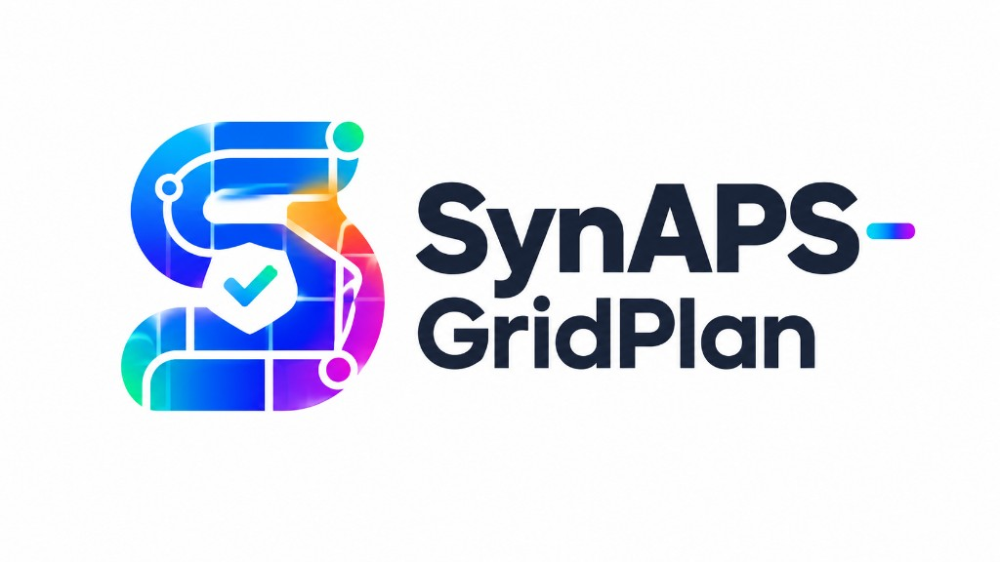
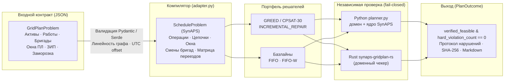

<div align="center">



### Календарно-ресурсное планирование и независимая верификация графиков ТОиР электросетевого оборудования поверх ядра [SynAPS](https://github.com/KonkovDV/SynAPS)

[](https://github.com/KonkovDV/SynAPS-GridPlan/actions/workflows/ci.yml?query=branch%3Amain)
[](https://www.python.org/)
[](LICENSE)
[](https://docs.astral.sh/ruff/)
[](http://mypy-lang.org/)
[](CITATION.cff)

</div>

Одна заявка сдвинулась. Бригада уже в пути, окно вывода занято, на складе последний комплект, а соседний ввод отключать вместе нельзя.

**SynAPS-GridPlan** собирает такой график и отдельно говорит, держится ли он. Слоты ищет ядро [SynAPS](https://github.com/KonkovDV/SynAPS). Правила читает свой чекер, на Python и на Rust. Есть жёсткое нарушение — план не выходит, код возврата `2`.

| Полка | Своё дело |
| --- | --- |
| Учёт работ | Карточка оборудования и заказ-наряд |
| Расчёт режима | Потоки, напряжение и критерий N-1. Этот контур их не считает |
| **График ТОиР** | Бригада, смена, переезд, окно вывода, ЗИП и заявка, которую уже нельзя сдвинуть |

Учебный РЭС запускается так. Полный разбор команд — в [разделе 6](#6-быстрый-старт-и-интерфейс-командной-строки).

```bash
pip install -r requirements.lock
pip install --no-deps -e .
python -m synaps_gridplan synthesize --mode res-severny --seed 7 -o severny.json
python -m synaps_gridplan solve severny.json --solver GREED -o severny_plan.json
python -m synaps_gridplan check severny.json severny_plan.json
```

---

| Поле | Значение |
| --- | --- |
| **Версия пакета** [V1] | **0.1.8** (`pyproject.toml`, `src/synaps_gridplan/versions.py`) |
| **Ветка по умолчанию** | `main` |
| **Пин ядра SynAPS** [V2] | [`6178c93b705ff58be21fa74a98651883a2da1169`](https://github.com/KonkovDV/SynAPS/commit/6178c93b705ff58be21fa74a98651883a2da1169) |
| **Уровень готовности** [V3] | TRL 4 по ISO 16290: лабораторные фикстуры, не пилот на предприятии (самооценка; не сертификация по ГОСТ Р 58048-2017; УГТ5 не заявляется — [`docs/UGT_GOST_R_58048.md`](docs/UGT_GOST_R_58048.md)) |
| **Словарь статусов** | Приёмка плана (`PlanOutcome.ok`) требует одновременно статуса в `{optimal, feasible}`, `verified_feasible = True` и `hard_violation_count == 0`. Эвристики (`GREED`, `FIFO`, `FIFO-W`, `INCREMENTAL_REPAIR`) никогда не выставляют `optimal`. Статус `optimal` выдаётся только если `CPSAT-30` доказал оптимум скомпилированной модели **и** независимый доменный чекер подтвердил `0` жёстких нарушений. При проверке внешнего JSON сохранённый флаг `optimal` не переиздаётся (`optimality_origin = "imported_not_reproven"`) |
| **Нативный контур (Rust)** | `native/synaps-gridplan-rs` (`cargo test --locked`) — независимый доменный чекер и календарный базлайн `FIFO`; не вызывает решатель `GREED`/`CP-SAT` и не подменяет проверку ядра `SynAPS` |
| **Тестовый инвариант** [T1] | `docs/TEST_COUNT.txt` (регенерируется через `python scripts/export_test_count.py`; CI падает при расхождении с `pytest --collect-only`) |
| **Реестр утверждений** | [`docs/CLAIMS_REGISTRY.md`](docs/CLAIMS_REGISTRY.md) · пакет воспроизведения: `python scripts/evidence_bundle.py` |
| **Границы модели** | [`docs/LIMITS.md`](docs/LIMITS.md) (обладает приоритетом над презентациями и заявками) · [`docs/limitations.md`](docs/limitations.md) · [`AUDIT.md`](AUDIT.md) |
| **Автор** | Коньков Д. В. (`@KonkovDV`) |

---

## Оглавление

1. [Назначение и архитектурная позиция](#1-назначение-и-архитектурная-позиция)
2. [Что лежит в репозитории](#2-что-лежит-в-репозитории)
3. [Математическая модель и граница компиляции](#3-математическая-модель-и-граница-компиляции)
4. [Портфель решателей и семантика `OPTIMAL`](#4-портфель-решателей-и-семантика-optimal)
5. [Лабораторные стенды и воспроизводимые результаты](#5-лабораторные-стенды-и-воспроизводимые-результаты)
6. [Быстрый старт и интерфейс командной строки](#6-быстрый-старт-и-интерфейс-командной-строки)
7. [Откуда взяты решения](#7-откуда-взяты-решения)
8. [Навигация по документации и конкурсным материалам](#8-навигация-по-документации-и-конкурсным-материалам)
9. [Структура репозитория](#9-структура-репозитория)

---

## 1. Назначение и архитектурная позиция

При составлении месячных и оперативных графиков технического обслуживания и ремонта (ТОиР) в электросетевых и генерирующих компаниях диспетчерская служба одновременно сводит:
- квалификацию и допуск выездных бригад (`required_qualifications`);
- сменные графики и окна доступности персонала (`shift_calendar`, `availability`);
- время переезда между подстанциями, фидерами и опорами (`travel_minutes`);
- согласованные окна вывода оборудования в ремонт (заявки ПЛ, `OutageWindow`);
- технологическую последовательность операций (например, «вывод в ремонт → работа на оборудовании → испытания → ввод в работу»);
- запреты одновременного отключения взаиморезервирующих элементов (`SimultaneousOutageBan`);
- наличие запасных частей и материалов на складе (`SparePart`) и неприкосновенность уже утверждённых диспетчерских слотов (`FrozenAssignment`).

В традиционной практике эти ограничения сводятся вручную в таблицах или фиксируются постфактум в учётной системе. При сдвиге одной заявки или появлении аварийного дефекта пересчёт вручную приводит либо к накладкам по оборудованию и срыву окон ПЛ, либо к лишним переездам и простою бригад.

**`SynAPS-GridPlan`** — доменный контур планирования и верификации графиков ТОиР поверх комбинаторного ядра [`SynAPS`](https://github.com/KonkovDV/SynAPS). Архитектура опирается на два принципа:

1. **Двухслойное разделение (Utility Outage Scheduling Layer 1 vs Layer 2).** В соответствии с промышленной практикой крупных энергосистем (Hydro-Québec TMS, CP 2022; Barral et al., CPAIOR 2024; см. [`PRACTICE.md`](PRACTICE.md) и [`docs/sota-cp-2026.md`](docs/sota-cp-2026.md)) `SynAPS-GridPlan` решает **первый (комбинаторный ресурсно-календарный) слой**: назначает бригады, окна ПЛ, технологические цепочки и таблично заданные запреты совмещения. **Второй слой** — расчёт потокораспределения AC/DC, токовых перегрузок, уровней напряжения и критерия N-1 — остаётся в специализированном электрическом симуляторе энергосистемы.
2. **Принцип fail-closed (независимая верификация поверх любого решателя).** Ни один план, построенный эвристикой (`GREED`, `FIFO`, `FIFO-W`, `INCREMENTAL_REPAIR`), точным решателем (`CPSAT-30`) или загруженный из внешнего JSON, не признаётся допустимым сам по себе. Независимый верификатор (`check_gridplan_constraints` в `constraints.py` и проверка ядра SynAPS в `planner.py`; тот же доменный слой в `synaps-gridplan-rs`) заново собирает индекс входной задачи. Если обнаружено хотя бы одно жёсткое нарушение, возвращается `verified_feasible = False`, а CLI завершается с кодом возврата `2`.



### Допустимое утверждение о продукте (Allowed claim)

> На детерминированных синтетических стендах электросетевого и генерирующего ТОиР (`res_severny`, `emergency_day`, `gres_block`, `dual_feed_hall`, `medium`, `stress`) `SynAPS-GridPlan` строит расписания работ и проверяет их независимым верификатором (Python и Rust) по правилам квалификации и смен бригад, переездов, окон отключения ПЛ, линейных цепочек технологического предшествования, эксклюзивности оборудования во время ремонта, попарных запретов одновременного вывода, складских квот ЗИП и заморозки согласованных слотов. Любое расписание с ненулевым числом жёстких нарушений отклоняется с кодом возврата `2`.

---

## 2. Что лежит в репозитории

| Проверяется в CI | Остаётся за этим контуром |
| --- | --- |
| Строгая схема входной задачи `GridPlanProblem` и результата `PlanOutcome` (`extra="forbid"`, `deny_unknown_fields`, обязательные часовые пояса ISO-8601 `Z`/`+03:00`) | Расчёт потокораспределения AC/DC, уровней напряжения, токов КЗ, динамической устойчивости и критерия **N-1** |
| Компилятор доменной задачи в `SynAPS` (`adapter.py`): календарь бригады, дробление длинной работы по сменам, переезды, линейные цепочки, заморозка слотов | Оптимизация или прямое моделирование показателей **SAIDI / SAIFI** как целевой функции |
| Независимая проверка `check_gridplan_constraints` (Python) и нативный крейт `synaps-gridplan-rs` (в дереве 61 функция `#[test]`; это счёт исходников, не журнал CI) | Живые производственные выгрузки ПАО «Россети», ПАО «ЭЛ5-Энерго», Конаковской ГРЭС или других ДЗО |
| Точный решатель `CPSAT-30` (OR-Tools CP-SAT через `SynAPS`), эвристика `GREED`, оперативный ремонт плана `INCREMENTAL_REPAIR`, базлайны `FIFO` и `FIFO-W` | Готовые промышленные коннекторы к 1С:ТОИР, SAP PM, Maximo, SCADA/EMS/OMS или парсеры CSV/XLSX в составе пакета |
| Fail-closed приёмщик JSON `synaps_gridplan.extract` (`prose`, `invalid_json`, `not_an_object`, `envelope`, `blank_quantity`, `invalid_problem`) | Сертификация по ГОСТ Р 58048-2017, аттестация КИИ по **187-ФЗ** или номер записи в Едином реестре российского ПО ([`docs/ru_software_registry.md`](docs/ru_software_registry.md)) |
| Воспроизводимые синтетические стенды (`B1`–`B5`, `B7`), генератор пакета доказательств `scripts/evidence_bundle.py`, аудит формулировок `scripts/lint_claims.py` и SBOM (`sbom/`) | Статус партнёра или подрядчика ПАО «Россети» (в конкурсных анонсах «Россети» — соорганизатор программы, а не заказчик GridPlan) |

### Что доказывает и чего не доказывает зелёный статус CI

- **Зелёный CI доказывает**, что на чистой виртуальной машине при зафиксированных lock-файлах (`requirements.lock`, `Cargo.lock`) и пине `SynAPS` `6178c93` проходят модульные и негативные тесты Python (`3.12`, `3.13`) и Rust (`cargo test --locked`), статическая типизация `mypy`, линтер `ruff check src tests scripts benchmark`, проверка `pip-audit` / `cargo-audit`, сверка `sbom/`, контроль текста презентации (`extract_deck_text.py --check`), линтер запрещённых формулировок (`lint_claims.py`) и числовые гейты реестра утверждений [`docs/CLAIMS_REGISTRY.md`](docs/CLAIMS_REGISTRY.md).
- **Зелёный CI не доказывает** готовность к промышленному вводу на подстанции без участия диспетчера, полноту электрической проверки режима (N-1), универсальную оптимальность эвристики `GREED` на произвольных графах или наличие проверенного сертификата доказательства (DRCP / VeriPB) поверх солвера CP-SAT.

---

## 3. Математическая модель и граница компиляции

Ниже приведена формальная спецификация реализованного в `0.1.8` контракта и точное распределение ограничений между компилятором `SynAPS` и независимым пост-чекером.

### 3.1. Множества и переменные

Имена полей — из `src/synaps_gridplan/model.py`. Метки времени — ISO-8601 со смещением; длительности — целые минуты.

- **Горизонт:** полуинтервал от `planning_horizon_start` до `planning_horizon_end`.
- **Активы:** `Asset`, площадка задаётся `location_code`.
- **Бригады:** `Crew`. Квалификации — `qualifications`, параллельная ёмкость — `max_parallel` (не меньше 1), база — `home_location_code`, смены — `shift_calendar`, доступность — `availability`.
- **Окна отключения:** `OutageWindow` привязано к активу, а не к списку окон внутри работы. У окна есть интервал `[start, end)` и флаги `approved`, `frozen`.
- **Склад:** `SparePart`. Полезный остаток — `available_quantity` минус `reserved_quantity`. Поле `stock_qty` — прежнее имя `available_quantity`. `lead_time_min` и `replenishment_date` задают, когда нулевой остаток становится доступен, и сами остаток не увеличивают.
- **Работы:** `MaintenanceJob`. Длительность `duration_min` не меньше 1 минуты. Квалификации — `required_qualifications`, признак отключения — `interruption_required`, границы — `release_date` и `latest_finish`, предшественники — `predecessor_job_ids`, позиции ЗИП — `spare_part_ids`. Допустимые бригады — `eligible_crew_ids`; пустой список означает все бригады с нужной квалификацией.
- **Назначение** работы — бригада и интервал `[start, end)`, либо цепочка суточных частей той же работы. Отдельной переменной «выбранное окно» в результате нет: окно выбирается при компиляции.

### 3.2. Что компилирует `adapter.to_schedule_problem`

1. **Квалификация.** В `eligible_wc_ids` попадают бригады, у которых есть требуемые квалификации и которые вмещают длительность части работы.
2. **Окно ПЛ.** Для работы с `interruption_required` компилятор берёт **самое раннее** одобренное окно актива, в которое работа помещается целиком после пересечения с `release_date` и `latest_finish`. Это одно окно, не объединение всех одобренных окон (`_job_clearance_bounds`).
3. **Календарь бригады** (`crew_calendar.compiled_crew_windows` → `WorkCenter.calendar`):
   - оба списка пусты — в солвер уходит пустой календарь, и это круглосуточная бригада;
   - ровно один список непуст — календарь равен ему;
   - оба непусты — берётся пересечение;
   - пересечение пусто — бригада закрыта: в календарь кладётся одна минута, целиком лежащая до начала горизонта, и круглосуточный режим не подставляется.
   - Занятость вместе с переездом должна лежать в одном открытом интервале: от `start` минус минуты переезда до `end`.
   - Если `duration_min` длиннее самого длинного открытого интервала, работа режется на суточные части одной цепочки; сумма длительностей равна исходной. Квалификация и ЗИП списываются один раз, с первой части.
4. **Переезды.** Непустая карта `travel_minutes` (ключ `{from}|{to}`) становится матрицей переналадок. Пропущенное ребро не заменяется молча выездом с базы: компилятор поднимает `ValueError`. Пустая карта — явный нулевой переезд.
5. **Предшествование.** Компилятор строит только линейные цепочки. Цикл, две входящие дуги или две исходящие отвергаются при загрузке JSON, в Python и в Rust.
6. **Заморозка.** `FrozenAssignment` с `immutable=True` и наследие `outage_windows[].frozen` (`legacy_freeze.py`) передаются солверу как зафиксированные назначения и удерживаются при `disrupt`.

Оболочка простоя — правило чекера, не правило выбора окна. У одной работы, разрезанной на части, занятость актива — от самого раннего `start` до самого позднего `end`. У запрета пары (`SimultaneousOutageBan`, поля `asset_id_a` и `asset_id_b`) занятость цепочки связанных отключений — оболочка от первого старта до последнего конца. Независимые работы на одном активе остаются отдельными интервалами. Так читается модель простоя Goel & Meisel (EJOR 2013) в этом коде.

### 3.3. Что остаётся постпроверкой

На пине `6178c93` и в просмотренном коммите `8921ead` ([`AUDIT.md`, §10](AUDIT.md)) занятость `AuxiliaryResource` начинается в момент `start` минус минуты переезда, а `pool_size` — параллельная ёмкость, минимум 1, и после операции ресурс возвращается в пул.

Поэтому актив и запрет пары в `AuxiliaryResource` не компилируются: иначе аппарат числился бы занятым, пока бригада ещё в пути. ЗИП компилируется иначе. Для каждой позиции создаётся вспомогательный ресурс с `pool_size = max(1, usable)`, и первая часть работы требует одну единицу. Это прокси одновременной ёмкости. Расход склада считает постпроверка: одна перечисленная позиция — одна единица, количественный BOM в `0.1.8` не задаётся.

| Код | Где считается | Смысл |
| --- | --- | --- |
| `ASSET_OVERLAP` | только постпроверка | два отключения одного актива не пересекаются |
| `SIMULTANEOUS_OUTAGE_BAN` | только постпроверка | оболочки двух активов из явного запрета не пересекаются; это не расчёт N-1 |
| `SPARE_PART_SHORTAGE` | постпроверка поверх прокси `pool_size` | сумма единиц больше `usable_quantity` |
| `SPARE_PART_NOT_YET_AVAILABLE` | постпроверка | при нулевом usable и пустой дате поставки старт раньше `planning_horizon_start` плюс `lead_time_min` запрещён; задержка остаток не создаёт |

### 3.4. Поля вне вердикта и приём JSON

`Asset.voltage_level`, `Asset.parent_asset_id`, `Asset.coordinates`, `Asset.failure_modes`, `SparePart.warehouse_location` принимаются и попадают в `unenforced_fields`. `SparePart.lead_time_min` жёсткий только при нулевом usable и без `replenishment_date`; иначе это предупреждение. Подробности — в [`docs/data-contract-v2.md`](docs/data-contract-v2.md).

`extract_problem` языковую модель не вызывает. Отказ называется так:

- `invalid_json` — строка не разбирается как JSON.
- `not_an_object` — разобранное значение не объект.
- `prose` — в корне есть `text`, `prompt`, `narrative` или `request`.
- `envelope` — ключ `problem` есть, но документ не равен одному этому объекту.
- `blank_quantity` — у позиции ЗИП нет ни `available_quantity`, ни `stock_qty`. Пустая ячейка не становится нулём.
- `invalid_problem` — объект не проходит схему `GridPlanProblem`.

---

## 4. Портфель решателей и семантика `OPTIMAL`

| Идентификатор | Роль в системе | Учитывает при поиске | Может ли заявлять `optimal`? |
| --- | --- | --- | --- |
| `FIFO` | Наивный календарный базлайн («первым пришёл — первым назначен» на первую подходящую по навыкам бригаду) | Навыки бригады и порядок следования заявок | **Нет** (`heuristic_feasible` только при `0` нарушений чекера) |
| `FIFO-W` | Календарно-оконный базлайн для сравнения в разделе E отчёта жюри | Навыки, сменный календарь бригады, одобренное окно ПЛ, переезд и завершение предшественника | **Нет** |
| `GREED` | Основной быстрый диспетчерский решатель `SynAPS` | Скомпилированная модель `ScheduleProblem` | **Нет.** Конфигурация с префиксом `GREED` получает `claim_status = heuristic_feasible` и статус `feasible` |
| `CPSAT-30` | Точный решатель OR-Tools CP-SAT через `SynAPS` с бюджетом 30 с | Скомпилированная модель `ScheduleProblem` с минимизацией makespan и нижней оценкой (`lower_bound`) | **Да, для скомпилированной модели**, только если CP-SAT доказал `OPTIMAL` **и** независимый доменный чекер подтвердил `0` жёстких нарушений |
| `INCREMENTAL_REPAIR` | Оперативное перепланирование (`disrupt`) при добавлении срочной заявки или смене условий | Полная перекомпиляция актуальной задачи с жёсткой фиксацией `FrozenAssignment(immutable=True)` | **Нет** |
| `synaps-gridplan-rs` | Нативный Rust-бинарник (`check`, `solve`, `synthesize`, `report`) | Независимая доменная верификация и календарный `FIFO` (без `GREED`/`CP-SAT`; при непустой матрице переездов не выставляет общий `verified_feasible`) | **Нет** (`status` в `check` не переиздаётся) |

> **Важное разграничение для раздела D (`CPSAT-30`):** в `CPSAT-30` оптимизируется **скомпилированная модель** (`ScheduleProblem`), поэтому сертификат оптимальности `CP-SAT` относится к ней. Эксклюзивность актива (`ASSET_OVERLAP`), попарные запреты (`SIMULTANEOUS_OUTAGE_BAN`) и расходуемый склад (`SPARE_PART_SHORTAGE`) проверяются независимым доменным чекером поверх найденного расписания. Если на конкретной постановке эти ограничения активны и нарушены кандидатом CP-SAT, план отклоняется чекером и не получает `verified_feasible = True`.

---

## 5. Лабораторные стенды и воспроизводимые результаты

Все количественные утверждения репозитория занесены в [`docs/CLAIMS_REGISTRY.md`](docs/CLAIMS_REGISTRY.md) и проверяются автотестами (`tests/test_claims_registry.py`, `tests/test_claims_truth.py`). Разные стенды используют **разные** синтетические генераторы и не складываются в единую шкалу.

| Код | Лабораторный стенд и проверяемый результат | Артефакт и команда воспроизведения |
| --- | --- | --- |
| **[B1]** | **Синтетический РЭС «Северный»:** `55` работ, `7` бригад, `39` активов | [`benchmark/results/jury_report.md`](benchmark/results/jury_report.md) · `python -m pytest tests/test_res_severny.py::test_res_instance_shape` |
| **[B2]** | На том же инстансе календарный `FIFO`: `107` жёстких нарушений; `GREED`: `0`, `verified_feasible` | тот же отчёт · `python benchmark/jury_benchmark.py` |
| **[B3]** | `CPSAT-30` на том же JSON: статус `optimal`, `0` жёстких нарушений, dual bound равен makespan | тот же отчёт, раздел D · `python benchmark/jury_benchmark.py --cpsat` |
| **[B4]** | Аварийные сутки: `23` работы; `FIFO` `27` жёстких нарушений, `GREED` `0` | [`benchmark/results/emergency_day_report.md`](benchmark/results/emergency_day_report.md) · `python benchmark/emergency_day_benchmark.py` |
| **[B5]** | `medium`, seed 12: `200` работ, `GREED` `0` нарушений, `FIFO` `40`; `stress`, seed 12: `600` работ, `GREED` `0`, `FIFO` `80` | [`benchmark/results/scale_report.md`](benchmark/results/scale_report.md) · `python benchmark/scale_benchmark.py` |
| **[B7]** | Время стены в отчётах — машина прогона, не норма обслуживания | [`benchmark/results/jury_report.md`](benchmark/results/jury_report.md) |

Раздел B того же отчёта жюри фиксирует перепланирование без сдвига замороженных строк ПЛ. Раздел E показывает базлайн `FIFO-W` на инстансе «Северный». Оба раздела читаются в файле отчёта; отдельных идентификаторов в реестре у них нет, и числа оттуда в эту таблицу не выносятся.

Дополнительно в репозитории представлены специализированные синтетические постановки:
- **`gres-block`** (`tests/test_gres_block.py`) — ремонт энергоблока ГРЭС с технологической цепочкой и окнами вывода;
- **`dual-feed-hall`** (`tests/test_dual_feed_hall.py`) — два независимых ввода питания машинного зала с табличным запретом одновременного отключения обоих лучей (`SIMULTANEOUS_OUTAGE_BAN`, структурный аналог ремонтопригодности без прерывания нагрузки; не реконструкция аварии конкретного дата-центра);
- **Нагрузочные пробы `scale-2k` и `scale-5k`** (`benchmark/scale_budget.py`, `.github/workflows/scale-budget.yml`) — внутренние CI-пробы времени и пика памяти `tracemalloc` на укладке кампаний (не входят в реестр продуктовых утверждений `CLAIMS_REGISTRY.md`).

---

## 6. Быстрый старт и интерфейс командной строки

### Установка и проверка окружения

Требуется **Python 3.12+**. Зависимости зафиксированы в `requirements.lock`, а ядро `SynAPS` привязано к коммиту `6178c93b705ff58be21fa74a98651883a2da1169`.

```bash
pip install -r requirements.lock
pip install --no-deps -e .
python -m synaps_gridplan version
```

### Основные сценарии CLI

**1. Полный пакет доказательств (стенд РЭС «Северный» + CP-SAT + проверочные гейты):**

```bash
python scripts/evidence_bundle.py
```

**2. Демонстрация принципа fail-closed через коды возврата CLI (`0` vs `2`):**

На малой синтетической фикстуре `small` с `--seed 12` решатель `GREED` строит расписание без конфликтов (код возврата `0`). На той же фикстуре с `--seed 42` два задания конкурируют за один отключаемый актив: поскольку эксклюзивность актива не передаётся в `AuxiliaryResource`, `GREED` ставит их параллельно, после чего независимый чекер перехватывает нарушение `ASSET_OVERLAP` и блокирует выдачу плана с кодом возврата `2`:

```bash
# Допустимый и верифицированный план -> код возврата 0
python -m synaps_gridplan synthesize --mode small --seed 12 -o problem_ok.json
python -m synaps_gridplan solve problem_ok.json --solver GREED -o plan_ok.json
python -m synaps_gridplan check problem_ok.json plan_ok.json

# Конфликт на активе (ASSET_OVERLAP) перехвачен чекером -> код возврата 2
python -m synaps_gridplan synthesize --mode small --seed 42 -o problem_conflict.json
python -m synaps_gridplan solve problem_conflict.json --solver GREED -o plan_conflict.json
```

Коды возврата CLI:
- `0` — расписание построено и прошло независимую проверку (`verified_feasible = True`, `hard_violation_count == 0`);
- `2` — расписание построено или прочитано, но независимый чекер обнаружил жёсткие нарушения ограничений (для исследовательской записи неверифицированного файла предусмотрен явный флаг `--allow-unverified`);
- `1` — ошибка аргументов командной строки, нарушение схемы входного JSON или превышение лабораторных квот чтения.

**3. Оперативное перепланирование (`disrupt`), генерация отчёта (`report`) и справка по слоям (`practice`):**

```bash
# Сгенерировать стенд РЭС «Северный», решить и внести возмущение без сдвига замороженных ПЛ
python -m synaps_gridplan synthesize --mode res-severny --seed 7 -o severny.json
python -m synaps_gridplan solve severny.json --solver GREED -o severny_plan.json
python -m synaps_gridplan disrupt severny.json severny_plan.json -o severny_replan.json
python -m synaps_gridplan report severny_replan.json --format markdown -o severny_report.md

# Вывести метаданные архитектурного слоя и ссылок на мировую практику
python -m synaps_gridplan practice
```

Доступные режимы синтезатора (`synthesize --mode`): `small`, `medium`, `stress`, `scale-2k`, `scale-5k`, `frozen-conflict`, `res-severny`, `gres-block`, `emergency-day`, `dual-feed-hall`.

**4. Нативный верификатор на Rust (`synaps-gridplan-rs`):**

```bash
cargo test --manifest-path native/synaps-gridplan-rs/Cargo.toml --locked
cargo run --manifest-path native/synaps-gridplan-rs/Cargo.toml --locked -- check severny.json severny_plan.json
```

**5. Локальный запуск всех проверок качества и реестра утверждений:**

```bash
pytest -q
python scripts/lint_claims.py
python scripts/extract_deck_text.py --check
python scripts/export_test_count.py
ruff check src tests scripts benchmark
ruff format --check src tests scripts
```

---

## 7. Откуда взяты решения

Разбор с DOI лежит в [`docs/sota-cp-2026.md`](docs/sota-cp-2026.md) и [`PRACTICE.md`](PRACTICE.md). Проценты чужих статей остаются там и на GridPlan **не переносятся**.

| Что видно в практике 2022–2026 | Что делает GridPlan |
| --- | --- |
| График бригад и окон живёт отдельно от режима сети (Popovic et al., CP 2022; Barral et al., CPAIOR 2024; Tang et al., Energies 2025) | Слой `combinatorial_crew_window_mutex_freeze`: бригады, окна, цепочки, попарный запрет. Потоки, напряжение и критерий N-1 остаются в симуляторе (`electrical_security = out_of_scope`) |
| Журнал DRCP удостоверяет записанную модель, не заявку диспетчера (Flippo et al., CP 2024 и CP 2026). OR-Tools CP-SAT такого журнала не отдаёт | Оптимум `CPSAT-30` — оптимум скомпилированной модели. Поверх ответа всегда стоит свой чекер. Чужой `optimal` не переиздаётся |
| Текст заявки, который модель сама превращает в задачу, оставляет скрытые ошибки (CP-Bench, CP-Agent, ConstraintBench) | `extract` отвергает прозу (`prose`) и позицию ЗИП без количества (`blank_quantity`). Расписание выпускает солвер и проверка |

---

## 8. Навигация по документации и конкурсным материалам

### Техническая и нормативно-справочная документация

| Документ | Содержание |
| --- | --- |
| [`docs/LIMITS.md`](docs/LIMITS.md) · [`docs/limitations.md`](docs/limitations.md) | Главный перечень ограничений модели, границы компиляции `AuxiliaryResource`, различие между оптимумом скомпилированной модели и полным ТЗ |
| [`docs/CLAIMS_REGISTRY.md`](docs/CLAIMS_REGISTRY.md) | Единый реестр проверяемых утверждений (`V1`–`V3`, `B1`–`B7`, `T1`, `P1`–`P11`, `M1`–`M6`), артефактов и команд воспроизведения |
| [`docs/sota-cp-2026.md`](docs/sota-cp-2026.md) · [`PRACTICE.md`](PRACTICE.md) | Обзор литературы 2022–2026: двухслойное планирование ремонтов сетей, DRCP/VeriPB и бенчмарки LLM-моделирования |
| [`docs/architecture.md`](docs/architecture.md) | Внутреннее устройство пайплайна компиляции, решения и проверки |
| [`docs/data-contract-v2.md`](docs/data-contract-v2.md) | Схема данных v2, правила валидации, `unenforced_fields`, маппинг табличного обмена и инварианты календаря бригад |
| [`docs/UGT_GOST_R_58048.md`](docs/UGT_GOST_R_58048.md) | Сопоставление самооценки ISO 16290 TRL 4 и требований ГОСТ Р 58048-2017 |
| [`docs/pp86_horizon_analogy.md`](docs/pp86_horizon_analogy.md) | Сопоставление годового/месячного контуров ПП РФ № 86 (вывод объектов диспетчеризации в ремонт) с моделью `OutageWindow` и `FrozenAssignment` |
| [`docs/ru_software_registry.md`](docs/ru_software_registry.md) | Справка по правилам Единого реестра российского ПО (ПП РФ № 1236 и № 1875) и текущему статусу открытого репозитория |
| [`docs/IP_AND_OPEN_CORE.md`](docs/IP_AND_OPEN_CORE.md) | Лицензионный инвентарь (MIT), SBOM и граница между открытым ядром и будущими заказными адаптерами |
| [`AUDIT.md`](AUDIT.md) · [`SECURITY.md`](SECURITY.md) | История технических аудитов fail-closed (0.1.5–0.1.8), ревью пина `SynAPS` и политика безопасности |

### Конкурсные пакеты и презентационные материалы

- **Акселератор «Энерготехнохаб Петербург»:** карточка сверки и параметров программы — [`docs/ETECHHUB_APPLICATION.md`](docs/ETECHHUB_APPLICATION.md), описание сценария ТОиР — [`docs/APPLICATION_TOIR_SCENARIO.md`](docs/APPLICATION_TOIR_SCENARIO.md), одностраничный паспорт пилота — [`docs/PILOT_ONEPAGER.md`](docs/PILOT_ONEPAGER.md). Согласно опубликованной странице программы, окно приёма заявок составляло **7 сентября – 2 октября 2026 года включительно** [P6]. Можно претендовать на приз **1 500 000 ₽** [P8]. Это потолок меры на странице программы, не выплата GridPlan.
- **Презентация проекта:** [`SynAPS_GridPlan.pptx`](SynAPS_GridPlan.pptx) (текстовый слепок слайдов контролируется в CI через [`docs/DECK_TEXT.txt`](docs/DECK_TEXT.txt) и `python scripts/extract_deck_text.py --check`). Статический веб-лендинг хранится в [`index.html`](index.html).
- **Архивные материалы прошлых отборов:** [`ACADEMY_APPLICATION.md`](ACADEMY_APPLICATION.md) (разбор условий 10-го потока Академии инноваторов, приём в который завершился 14 сентября 2026 года) и [`APPLICATION.md`](APPLICATION.md) / [`_SUBMIT_MIK_2026_08_18/`](_SUBMIT_MIK_2026_08_18/) (исторический срез 0.1.4 для августовского марафона МИК).

---

## 9. Структура репозитория

```text
SynAPS-GridPlan/
├── src/synaps_gridplan/
│   ├── model.py                 # Контракты Pydantic: GridPlanProblem и каталоги
│   ├── adapter.py               # Компиляция в ScheduleProblem ядра SynAPS
│   ├── constraints.py           # Доменная постпроверка, включая оболочки отключений
│   ├── planner.py               # Сборка плана, fail-closed и независимый check
│   ├── baselines.py             # FIFO и FIFO-W
│   ├── crew_calendar.py         # Пересечение смен и доступности
│   ├── legacy_freeze.py         # Заморозка из outage_windows[].frozen
│   ├── extract.py               # Приём JSON: шесть причин отказа, без языковой модели
│   ├── synthetic.py             # Генераторы стендов, включая res_severny и фидеры
│   └── cli.py                   # synthesize, solve, check, disrupt, report, practice
├── native/synaps-gridplan-rs/   # Доменный чекер и календарный FIFO; 61 функция #[test]
├── benchmark/                   # Стенды и зафиксированные отчёты в benchmark/results/
├── scripts/                     # evidence_bundle.py, lint_claims.py, сверка слайдов, SBOM
├── schemas/                     # JSON Schema
├── sbom/                        # CycloneDX по lock-файлам
├── docs/                        # Границы, реестр утверждений, обзор литературы, справки
└── tests/
```

---

## Лицензия и цитирование

Код репозитория распространяется на условиях лицензии [MIT](LICENSE). При упоминании в научных и инженерных публикациях используйте метаданные из [`CITATION.cff`](CITATION.cff).
